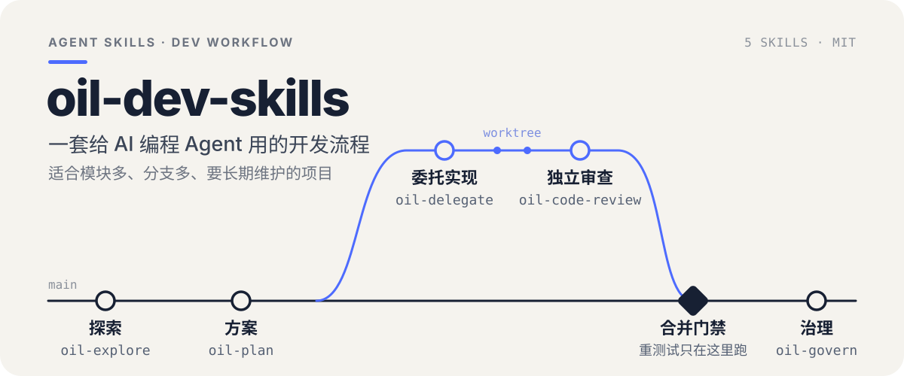
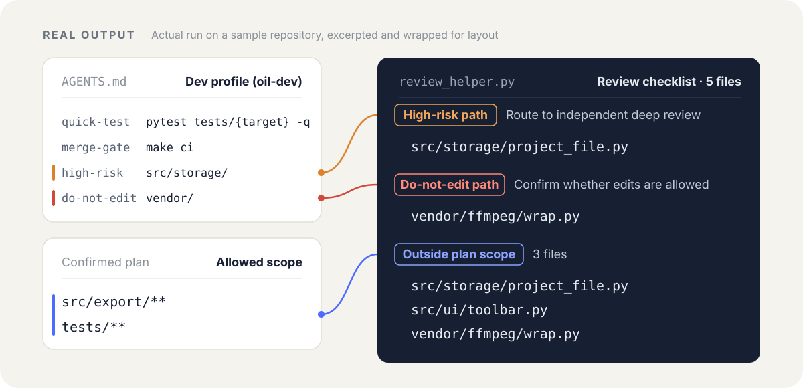

<p align="center">
  
</p>

`oil-dev-skills` 是六个配合使用的 Agent Skill，装进 Claude Code、Codex 等支持 Skill 的编程 Agent 后，用自然语言就能调用。它们把一次改动拆成五步：先摸清代码，再写一份你看得懂的方案，按契约交给 Agent 实现，改完独立审查，阶段结束时整理文档、测试和 Worktree。遇到原因不明的缺陷时，另有一条先找根因、再修复的路径。

每个 Skill 都能单独使用。小改动不用走完整流程，Agent 说清改法后直接改，再跑一次相关的快测。

## 它解决什么问题

项目变大以后，直接让 AI 改代码，常会遇到下面这些情况。每一条都对应流程里的一个具体做法：

- **没看清现有代码就动手，又写了一份重复的工具函数。** `oil-explore` 先只读地查清调用链，并列出能复用的组件和函数。
- **方案写得太技术，看不出到底要改什么。** `oil-plan` 用“外部有什么变化、复用什么、这次不做什么”来讲方案，把需要你拍板的取舍单独列出来。
- **每改两行就跑一遍全量测试，时间都花在等待上。** 派发契约规定编码途中只跑编译、类型检查和 lint 这类秒级检查，写完再跑和这次改动相关的快测；全量测试和构建留到合并前再跑。
- **改动超出了方案范围，或者碰了不该碰的目录。** 审查开始前，脚本会先对照方案和项目约定，把这些文件单独列出来。
- **修 bug 只挡住了症状，同样的写法在别处还留着。** `oil-bug-fix` 先复现、找到根因，在坏数据产生的地方修；再判断是不是普遍问题，是就全仓排查，并提议自动检查或审查重点，防止再犯。
- **`AGENTS.md` 跟真实代码对不上，旧的 Worktree 越堆越多。** `oil-govern` 检查文档死链和新鲜度、测试分层和 Worktree 合入状态，再给出整理建议。

## 审查前，先对一遍范围

下面是在一个示例仓库上的实际运行。仓库的 `AGENTS.md` 写明 `src/storage/` 是高风险目录、`vendor/` 不能手改；已确认的方案只允许改 `src/export/**` 和 `tests/**`。实现完成后，`oil-code-review` 自带的采集脚本在审查开始前，就把三类需要注意的文件列了出来：

<p align="center">
  
</p>

接下来审查会这样处理它们：

- **高风险目录**里的改动，交给一个干净上下文的 Agent 做独立深审。
- **禁改目录**里的改动，除非方案明确允许，否则列为阻塞问题。
- **超出方案范围**的文件逐个确认：确实必要的向你说明，顺手发散的列为阻塞问题。

## 六个 Skill

- **探索 · [`oil-explore`](skills/oil-explore/SKILL.md)**：只读盘点仓库的目录规模、规范文件和真实可用的测试、构建命令；大项目按模块分给几个只读子 Agent 并行查调用链。
- **方案 · [`oil-plan`](skills/oil-plan/SKILL.md)**：按轻重分三级。小改动直接改；常规需求在对话里对齐方案；跨模块改造写成规格文档，可以拆到多个 Worktree 并行。实现完成后验收，再按清单收尾合并。
- **委托 · [`oil-delegate`](skills/oil-delegate/SKILL.md)**：把任务交给本机已安装的 Claude Code、Codex、Antigravity 等 CLI Agent，结果带回当前会话，也能接着追问。代码审查、方案挑刺、疑难会诊和实现可以分别记住交给谁。
- **审查 · [`oil-code-review`](skills/oil-code-review/SKILL.md)**：只审代码。先对照方案查越界，再按风险分级。界面微调走轻量核验；核心逻辑和高风险改动从五个方面深审，包括业务闭环、复用、冗余、运行期错误、安全与兼容。
- **修缺陷 · [`oil-bug-fix`](skills/oil-bug-fix/SKILL.md)**：处理原因还不清楚的缺陷。先写一个会失败的测试复现问题，再用历史二分、往回追错误值或对照实验找到根因；判断是个例还是普遍问题，普遍问题全仓排查并一起修，再提议写成自动检查或加一条审查重点。原因已经清楚的小修补直接走 `oil-plan`。
- **治理 · [`oil-govern`](skills/oil-govern/SKILL.md)**：体检文档、测试和 Worktree，帮你生成和维护项目开发约定，并把项目里的硬规则写成仓库内的自动检查。

## 安装

把下面这句话发给你的 Agent：

```text
请帮我安装这个 Skill 仓库：https://github.com/oil-oil/oil-dev-skills
```

也可以用命令行安装整套：

```bash
npx skills add oil-oil/oil-dev-skills
```

只想装其中一个，用 `--skill` 指定名称：

```bash
npx skills add oil-oil/oil-dev-skills --skill oil-code-review
```

安装后不需要额外配置：

- `oil-explore`、`oil-plan`、`oil-code-review`、`oil-govern` 的脚本只读取 Git 和文件结构，不需要 API Key，也不限定编程语言。
- `oil-delegate` 第一次使用时，会自动找出本机已安装的 CLI Agent，问你要启用哪些。
- 代码审查、方案挑刺这类用途交给谁，第一次用到时问你一次就记住了，之后也可以直接说“以后 review 都交给 codex”。这些偏好保存在本机 oil-delegate 自己的配置里，不写进项目。
- 如果之前单独装过 [oil-delegate](https://github.com/oil-oil/oil-delegate)，装整套后只保留一份，避免出现两个同名 Skill。

## 怎么用

直接用自然语言告诉 Agent 要做什么。一个跨模块的需求，通常按下面的顺序走：

```text
先用 oil-explore 摸清这个项目里导出视频的完整调用链，看看有哪些现成的组件和函数可以复用。
```

```text
我想给时间轴加上多选批量剪切，用 oil-plan 写一份我能看懂的方案，把需要我拍板的取舍列出来，先别改代码。
```

```text
方案没问题，通过 oil-delegate 交给 codex 按方案实现，写完跑相关的快测就行。
```

```text
用 oil-code-review 审一下当前分支的改动，重点看核心业务和打包后的运行有没有隐患。
```

```text
用 oil-govern 给全仓做一次体检，看看文档有没有过期、测试分层合不合理、哪些 Worktree 可以清理。
```

审查通过后，`oil-plan` 会按收尾清单跑一次合并门禁，按仓库约定提交合并，再清理已经合入的 Worktree。

遇到原因不明的缺陷，直接描述现象就行：

```text
用 oil-bug-fix 查一下：海外用户说每日报表里有些订单被算到了前一天，我们这边没发现。
```

## 项目开发约定（推荐）

在目标仓库的 `AGENTS.md` 里加一个标题含 `oil-dev` 的小节，写下快测命令、合并门禁、高风险目录和禁改目录：

```markdown
## 开发约定（oil-dev）

- 快测：`pytest tests/{target} -q`
- 门禁：`make ci`
- 高风险：`src/storage/**`、`src/auth/**`、`migrations/`
- 禁改：`vendor/`、`src/generated/**`
```

写好之后，几个 Skill 会直接读取它：`oil-explore` 不用再猜测试命令，`oil-plan` 把快测和门禁写进派发契约，`oil-code-review` 像上面的例子那样标出高风险和禁改的文件。没有这一节时，各 Skill 按内置的默认规则判断。

不想手写的话，对 Agent 说“用 oil-govern 帮我生成开发约定”。格式和生成步骤见 [dev-profile.md](skills/oil-govern/references/dev-profile.md)。

## 个人偏好

只跟你自己有关的设置，写在本机的 `~/.oil-dev/preferences.md`。整个系列共用这一个文件，每个 Skill 一节，用自然语言写；紧跟在 Skill 标题下的文字对所有宿主生效，`### 宿主名` 下面的只对那个宿主生效。它不进项目仓库，团队共享的约定仍然写在上面的开发约定里。

目前 `oil-explore` 会在需要并行探索时读取它。你可以写清楚在不同宿主里怎么派发探索子 Agent：用哪种机制、什么模型、最多派几个、结束后怎么回收。

```markdown
## oil-explore

探索子 Agent 最多 3 个。

### antigravity

- 用 swarm 派发探索子 Agent，每个 Worker 用 `<模型 ID>`。
- 收齐所有简报后结束 Worker。

### claude-code

- 用 Explore 子 Agent，模型 haiku。
```

可以直接打开文件改，也可以告诉 Agent，由它整理后保存：

```text
以后在 Claude Code 里用 oil-explore，探索子 Agent 用 haiku，最多派 3 个。
```

没有写的部分按默认做法：选轻量快速的模型，派 2–3 个。`oil-delegate` 的偏好（启用哪些 CLI Agent、各用途交给谁）保存在它自己的配置里，不在这个文件中。

## 权限与适用边界

- `oil-explore` 全程只读。`oil-code-review` 和 `oil-govern` 采集事实时也只读；要改规范文档、删测试或移除 Worktree 时，会先给出依据，等你确认。
- `oil-plan` 在需要你拍板的问题确认之前，不会开始跨模块的修改。
- `oil-bug-fix` 找根因期间只加测试和临时日志，不改产品代码；新增自动检查、改 `AGENTS.md` 或 `REVIEW.md` 之前会先问你。
- 通过 `oil-delegate` 做代码审查、方案挑刺和疑难会诊时，自动使用只读模式，结束后检查工作区有没有变化。派发写代码的任务前，要求工作区是干净的，或者使用独立的 Worktree。
- 交给外部 CLI Agent 的任务描述和相关文件，会发送给对应的模型服务商，可能产生费用。不要把密钥或凭据写进任务描述。
- 脚本只依赖 Python 3.10+ 标准库。目前在 macOS 上测试过，Linux 和 Windows 还没有实机验证。
- 这套 Skill 不负责打包和发布。签名、公证、部署这些步骤跟具体产品关系很大，建议写成目标仓库自己的脚本。

<details>
<summary>维护与测试</summary>

运行全部单元测试，不调用任何模型，不到一分钟就能跑完：

```bash
python3 scripts/verify_repo.py
```

装了 [oil-skill-creator](https://github.com/oil-oil/oil-skill-creator) 的话，加上 `--validator <oil-skill-creator 目录>/scripts/validate_skill.py`，还会检查每个 Skill 是否符合公开发布的写法规范。

`skills/oil-delegate` 和独立仓库 [oil-delegate](https://github.com/oil-oil/oil-delegate) 保持一致。同时维护两边时，可以用同步脚本检查：

```bash
python3 scripts/sync_delegate.py --check
```

</details>

## License

[MIT](LICENSE)
