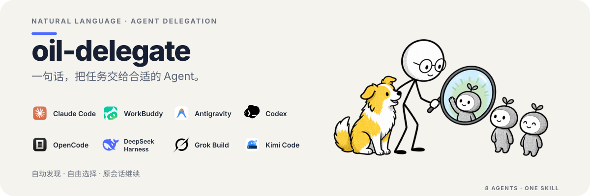

<p align="center">
  
</p>

## 有什么用

如果你已经在使用多个 Agent，`oil-delegate` 让你不用记住每家的命令和用法。只要把任务说清楚，它就会交给指定的 Agent，并把结果带回来。

- **自动发现**：第一次使用时，自动找出本机已有的 Agent。
- **自由选择**：由你决定启用哪些 Agent，以及是否设置一个默认 Agent。
- **按用途记住**：可以分别指定谁做代码审查、方案评审、疑难会诊和功能实现。第一次用到时问你一次，之后配套 Skill 会自动交给对应的 Agent，不用每次再说。
- **连续对话**：得到结果后可以接着追问或返工，不用重复前面的背景。

它适合代码检查、问题诊断、功能修改、方案评审，也适合让另一个 Agent 提供独立意见。

## 支持哪些 Agent

你可以使用全名，也可以使用顺手的简称，不区分大小写：

| Agent | 简称与别名 |
| --- | --- |
| Claude Code | `cc`、`claude`、`claude-code` |
| WorkBuddy | `wb`、`workbuddy`、`codebuddy`、`cbc` |
| Antigravity | `agy`、`antigravity` |
| Codex | `codex` |
| OpenCode | `opencode` |
| DeepSeek Harness | `dsh`、`deepseek`、`deepseek-harness` |
| Grok Build | `grok`、`grok-build` |
| Kimi Code | `kimi`、`kimi-code` |

## 怎么用

### 1. 安装 Skill

最简单的方式是把下面这句话发给你的 Agent：

```text
请帮我安装这个 Skill：https://github.com/oil-oil/oil-delegate
```

也可以使用命令安装：

```bash
npx skills add oil-oil/oil-delegate
```

安装完成后，按 Agent 的提示重新加载 Skill 即可。

### 2. 第一次使用：自动检查，再让你选

第一次委托时，它会自动检查本机环境，不需要你手动运行命令。检查完成后，你只需要回答两个问题：

1. 要启用哪些 Agent？
2. 默认使用哪一个，还是每次委托时再选？

确认后才会保存配置。检查过程不会调用模型、安装软件或替你登录；如果某个 Agent 还没有登录或不可用，它会如实告诉你。

### 3. 以后直接说

```text
用 cc 检查这个仓库的登录流程，只读分析并告诉我问题在哪里。
```

```text
让 wb 修复这个测试，修改后运行相关检查。
```

```text
用 agy 评审这个方案，再继续追问它遗漏的风险。
```

```text
让 dsh 分析当前项目，并继续刚才的会话。
```

```text
用 grok 实现这个功能，让 kimi 再检查一遍。
```

```text
以后代码审查都交给 codex，方案评审用你自己就行。
```

没有指定 Agent 时，它会使用你的默认选择；如果没有设置默认值，会先问你，不会擅自更换。默认按最高权限派发，尽量避免任务停在常规审批上；你明确要求只读时才会限制权限。代码审查、方案评审和疑难会诊这三类用途一律只读。

## 使用条件与边界

- 需要 Python 3.10 或更高版本，以及至少一个已经安装并登录的受支持 Agent。macOS 已实测 Antigravity、Codex 和 Kimi Code 的新建与续接，以及 Antigravity、Codex 的真实写入；其他 Agent 能否直接完成任务，取决于本机登录和模型配置。Linux 和 Windows 尚未实机验证。
- 任务内容会交给你选择的 Agent 及其模型服务，可能产生费用。不要在任务中放密钥。
- 默认最高权限意味着 Agent 可以修改文件、执行命令，部分 Runner 还可以访问工作区外内容。静态 deny、管理锁和登录问题仍可能造成失败。重要项目请先确认修改范围，并检查结果和测试。

<details>
<summary>维护、测试与排查</summary>

在仓库目录运行回归测试，不需要调用外部模型：

```bash
python3.10 -m unittest discover -s tests -p "test_*.py" -v
```

特定 Agent 的调用差异与失败处理见 [Runner 适配参考](references/runners.md)。发现问题时，可以带上 Runner、实际版本和错误日志到 [GitHub Issues](https://github.com/oil-oil/oil-delegate/issues) 反馈。

</details>

## License

[MIT License](LICENSE)。图标与配图来源见[素材说明](assets/readme/NOTICE.md)。
